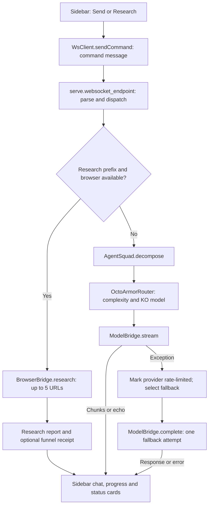
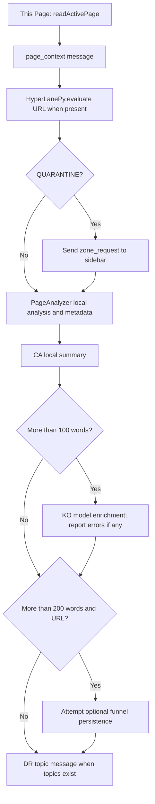
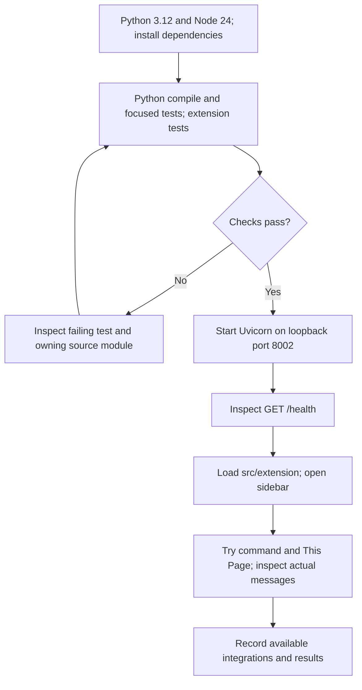

# Runtime flows and development procedure

Use this guide to trace the sidebar into the Python runtime and to bring up a standalone checkout. The diagrams describe the code at `532ea8a11055a8451b7de2644cbac05a8199e21a`; integrations listed as optional below are not included in this repository.

## Where to start

| Task | Entry point |
| --- | --- |
| Sidebar events and UI updates | [sidepanel.js](../src/extension/sidepanel.js) |
| Message envelope, buffering and reconnect | [ws-client.js](../src/extension/lib/ws-client.js), [ws_feed.py](../src/aetherbrowser/ws_feed.py) |
| HTTP health and WebSocket dispatch | [serve.py](../src/aetherbrowser/serve.py): `health`, `websocket_endpoint` |
| Task assignments and model selection | [agents.py](../src/aetherbrowser/agents.py), [router.py](../src/aetherbrowser/router.py) |
| Provider creation, streaming and echo fallback | [model_bridge.py](../src/aetherbrowser/model_bridge.py) |
| Optional browser research and persistence | [browser_bridge.py](../src/aetherbrowser/browser_bridge.py) |
| Page analysis and URL classification | [page_analyzer.py](../src/aetherbrowser/page_analyzer.py), [hyperlane_py.py](../src/aetherbrowser/hyperlane_py.py) |
| Local startup via native messaging | [host.py](../src/extension/native_messaging/host.py), [installer](../src/extension/native_messaging/install.py) |

## Command flow

`sidepanel.js` sends a `command` message with `payload.text`. The server recognizes `[Research] topic`, `research: topic`, and `research topic` case-insensitively. Browser research requires both a recognized prefix and an available browser bridge.



The Research button currently adds `[Research]` only to the displayed user message; its outbound message contains the original input. Type a recognized prefix in the input to request the browser lane. Without the optional browser implementation, that same command follows the normal model path.

The normal command path invokes the KO model. Other roles receive assignment/status messages; a DR summary is extracted locally when there are more than two assignments and a nonempty response. These status updates do not imply six independent model calls.

### Standalone integrations

- `ModelBridge` tries to import `hydra.llm_providers.create_provider`. That module is absent from this checkout. Missing provider implementation, missing required key, or provider creation failure produces an echo response. Setting an API key alone does not install the missing implementation.
- Backend provider keys are read from its process environment (`ANTHROPIC_API_KEY`, `GOOGLE_API_KEY`, `XAI_API_KEY` as mapped in the bridge). Sidebar settings are local extension storage; the sidebar does not forward stored API keys to the Python process.
- `BrowserBridge` imports `src.browser.hydra_hand` and `src.browser.research_funnel`, which are also absent from this checkout. Installing Playwright alone does not supply those modules. `browser_available: false` is the expected standalone result.
- `/health.providers` reflects configured key checks and includes the local slot. It does not verify that the provider factory can load or that a model call succeeds.
- Persistence happens only when a funnel instance was initialized. The standalone checkout does not automatically write JSONL or publish to Notion/Hugging Face.

See [model_bridge.py](../src/aetherbrowser/model_bridge.py) and [browser_bridge.py](../src/aetherbrowser/browser_bridge.py) for the import guards.

## Current-page analysis flow

The This Page action uses the content script to read the active tab, then sends `page_context` with URL, title and text. Its word-count thresholds are separate: enrichment starts above 100 words; persistence is attempted above 200 words when a URL exists.



The existing page handler emits a zone request and continues analysis immediately. A `zone_response` currently produces an acknowledgement chat message; it does not suspend, resume or cancel page processing. The handler also does not stop on a `DENY` result. This diagram documents the current control flow; it should not be treated as an enforced approval boundary. Source: [`_handle_page_context` and `_handle_zone_response`](../src/aetherbrowser/serve.py).

## Bring up a checkout

Run commands from the repository root. Use Python 3.12 and Node.js 24 to match [CI](../.github/workflows/ci.yml).

1. Create and activate an isolated Python environment:

   ```sh
   python -m venv .venv
   ```

   POSIX shell: `source .venv/bin/activate`. Windows PowerShell: `.venv\Scripts\Activate.ps1`.

2. Install the dependencies used by CI and run its checks:

   ```sh
   python -m pip install pytest pytest-asyncio fastapi uvicorn httpx websockets pydantic
   python -m py_compile src/aetherbrowser/*.py src/extension/native_messaging/*.py
   python -m pytest -q tests/aetherbrowser/test_model_bridge.py tests/aetherbrowser/test_serve.py tests/test_native_messaging_host.py
   npm ci
   npm run test:extension
   ```

3. Start the local server in that environment:

   ```sh
   python -m uvicorn src.aetherbrowser.serve:app --host 127.0.0.1 --port 8002
   ```

4. In a second terminal, check the health payload:

   ```sh
   curl http://127.0.0.1:8002/health
   ```

   Check `status`, `version`, the six agent entries, and `browser_available`. A healthy echo-only checkout is distinct from a working external-provider integration.

5. Open `chrome://extensions`, enable Developer mode, choose **Load unpacked**, and select `src/extension`. Open the extension sidebar. The default port in [storage.js](../src/extension/lib/storage.js) is 8002; change Settings if the server uses another port.

6. Send a short command and inspect chat/stream and status messages. Use This Page on a normal web page to exercise local analysis. Record whether the response is echo, an external provider response, or an error.



Native messaging is optional; starting Uvicorn manually is enough for this procedure. To enable the one-click launcher later, copy the extension ID from Chrome and register that exact ID:

```sh
python src/extension/native_messaging/install.py install --id YOUR_EXTENSION_ID
python src/extension/native_messaging/install.py status
```

The installer writes the native-host manifest to the browser's platform-specific location and, on Windows, registers a per-user key. Run it with the Python environment that has the runtime dependencies installed.

## Troubleshooting and evidence

| Symptom | First place to inspect |
| --- | --- |
| Sidebar remains disconnected | Uvicorn terminal, matching port, then [WsClient](../src/extension/lib/ws-client.js) |
| Native launcher fails | [Native host registration](../src/extension/native_messaging/install.py); use manual Uvicorn startup to isolate it |
| Response starts with Echo | [ModelBridge](../src/aetherbrowser/model_bridge.py): optional provider factory and process environment |
| Research behaves like chat | Input prefix, `/health.browser_available`, and [BrowserBridge import guards](../src/aetherbrowser/browser_bridge.py) |
| Page cannot be read | [dom-reader.js](../src/extension/lib/dom-reader.js): active tab and content-script response |
| Queue-pressure message | Client drops the oldest item at capacity: 256 outbound messages, 512 inbound messages by default |
| Reconnect after server restart | Client retries with exponential backoff, capped at 30 seconds plus jitter, and flushes its outbound queue after connection |

The [server tests](../tests/aetherbrowser/test_serve.py) cover message dispatch, prefixed research fallback, mocked research reports and disconnect behavior. The [extension tests](../tests/extension/ws-client.test.ts) exercise reconnect and queue behavior. Passing mocked tests does not establish that an external research backend, provider credential, or browser UI works in a particular deployment.
